# Execution Results and Bug Reports

**Date:** 2026-10-25 (UTC) · **Build:** https://qae-assignment-tau.vercel.app/ (Version 1.0.0) · **Browser:** Chrome 155, desktop
**How:** API calls with Python `requests`; UI checks in Chrome driven by Selenium, with screenshots.
Every call and balance read is logged in [`evidence/`](evidence/).
**Test data:** future match `mls-atlanta-seattle-2026-10-28` (Atlanta United vs Seattle Sounders,
odds 2.65 / 3.40 / 2.45); past match `premier-league-manutd-chelsea` (Manchester Utd vs Chelsea, 2026-02-27).
**Screenshots of API calls** come from Swagger UI (`/api/docs`). The curl block is hidden because it
contains the user id; the `date` response header gives the time of each call.

## Summary

| ID | Scenario | Result | Bugs |
|----|----------|--------|------|
| TC-01 | Valid bet: slip, receipt and balance agree | ❌ Fail | BUG-05, BUG-06, BUG-07, BUG-08 |
| TC-02 | Stake rules are enforced on UI and API | ❌ Fail | BUG-01, BUG-02 |
| TC-03 | Only pre-match events accept bets | ❌ Fail | BUG-03 |

**13 bugs reported** (3 Critical · 4 High · 6 Medium), plus 8 minor findings. The three Critical bugs
all let money move in a way the business rules forbid, and two of them can be reached by any user
through the normal UI.

| ID | Title | Severity |
|----|-------|----------|
| BUG-01 | Negative stake is accepted and adds money to the balance | Critical |
| BUG-02 | Balance can go negative, through the API and through the normal UI | Critical |
| BUG-03 | Matches already played are listed as upcoming and accept bets | Critical |
| BUG-04 | Simultaneous requests can charge the same bet twice | High |
| BUG-05 | Receipt shows a potential payout of stake × 2 | High |
| BUG-06 | Receipt names the away team first | High |
| BUG-07 | Header and slip balance stay stale after a bet | High |
| BUG-08 | Receipt has no selection, and its Bet ID and time come from the browser | Medium |
| BUG-09 | Slip promises a payout one cent higher than the one recorded | Medium |
| BUG-10 | Date filter shows matches one day early for users west of UTC | Medium |
| BUG-11 | Odds filter hides matches on its lower bound and accepts a reversed range | Medium |
| BUG-12 | Balance reset reports €125.50 but stores €120.00 | Medium |
| BUG-13 | Bet confirmation reports the currency as USD | Medium |

---

## Scenario results

### TC-01 – Valid bet (UI, automated E2E run twice with the same result)

Bet: Atlanta United vs Seattle Sounders, Home @ 2.65, stake €10.00, starting balance €120.00.

| Check | Expected | Actual | |
|-------|----------|--------|---|
| Header balance on load | €120.00 | €120.00 | ✅ |
| Slip potential payout | €26.50 | €26.50 | ✅ |
| Button while submitting | `Placing...` | `Placing...` | ✅ |
| Receipt match | Atlanta United vs Seattle Sounders | **Seattle Sounders vs Atlanta United** | ❌ BUG-06 |
| Receipt selection | Home | **not shown** | ❌ BUG-08 |
| Receipt stake / odds | €10.00 / 2.65 | €10.00 / 2.65 | ✅ |
| Receipt potential payout | €26.50 | **€20.00** | ❌ BUG-05 |
| Bet ID and timestamp | present | present (generated in the browser) | ⚠️ BUG-08 |
| Backend balance | €110.00 | €110.00 | ✅ |
| Header balance after the bet | €110.00 | **€120.00** | ❌ BUG-07 |
| Slip after closing the receipt | no selection | no selection | ✅ |
| `currency` in the API response | EUR | **USD** | ❌ BUG-13 |

### TC-02 – Stake rules

| Stake | UI (fresh page, balance €20.00) | API | API balance after | |
|-------|-----|-----|-------------------|---|
| *(empty / omitted)* | Place Bet disabled | 422 `invalid_stake_type` | unchanged | ✅ |
| `abc` / `"10"` | not accepted | 422 `invalid_stake_type` | unchanged | ✅ |
| `-5` | sign removed by the input | **200** | **+€5.00** | ❌ BUG-01 |
| `0` / `0.99` | "Minimum stake is €1.00", disabled | 422 `invalid_stake_min` | unchanged | ✅ |
| `1.00` / `1.01` | enabled | 200 | − stake | ✅ |
| `100.00` | enabled | 200 | − stake | ✅ |
| `100.01` | "Maximum stake is €100.00", disabled | 422 `invalid_stake_max` | unchanged | ✅ |
| `1.005` | input keeps `1.00` | 422 `invalid_stake_precision` | unchanged | ✅ |
| balance + 0.01 | "Insufficient balance", disabled | **200** | **goes negative** | ❌ BUG-02 |
| balance + 0.01, after a bet without reload | **enabled** (stale balance) | **200** | **goes negative** | ❌ BUG-02 |
| stake = balance (€20.00) | enabled | 200 | → €0.00 | ✅ |

`1.00` is accepted and `0.99` rejected with "Stake must be at least 1.00": the system applies €1.00 as
the minimum (test plan A1; the spec conflict is still open).

The "stake = balance" row was blocked in the first pass: BUG-02 had already left the balance
negative, so there was no valid balance to bet. It was rerun on its own after a reset (balance
€120.00 → €100.00 bet → €20.00 → stake €20.00 accepted, balance €0.00).

### TC-03 – Pre-match only

| Check | Expected | Actual | |
|-------|----------|--------|---|
| Past matches in "Upcoming Football Matches" | not listed | **86 of 103** listed, tagged PAST | ❌ BUG-03 |
| UI bet on Manchester Utd vs Chelsea (2026-02-27) | not possible | **placed**, receipt `#B-74128` | ❌ BUG-03 |
| API bet on the same match | 4xx | **200**, balance 120 → 115 | ❌ BUG-03 |
| API bet on the future control match | 200 | 200 | ✅ |

---

## Bug reports

### BUG-01 – Negative stake is accepted and adds money to the balance

**Severity:** Critical

**Reproduction steps**
1. `POST /api/reset-balance`, then `GET /api/balance` → €120.00.
2. `POST /api/place-bet` with `{"matchId": "mls-atlanta-seattle-2026-10-28", "selection": "HOME", "stake": -5}`.
3. `GET /api/balance`.

**Expected:** `422 invalid_stake_min`; balance unchanged. A stake must be a positive amount of at least
€1.00 (§3, §4.1; Domain Context "Stake").

**Actual:** `200 Bet placed successfully`, `"stake": -5, "payout": -13.25`, and the balance goes **up**
to €125.00. `0` and `0.99` are rejected, so the minimum check exists but ignores negative values.

**Business impact:** Anyone with a valid user id can add money to their account at no risk, without limit.

**Evidence:** reproduced three times (evidence log 22:23 UTC, Swagger 22:52 UTC, automated test
`test_invalid_stake_is_rejected_without_moving_money[negative]`, marked `xfail` with this ID).

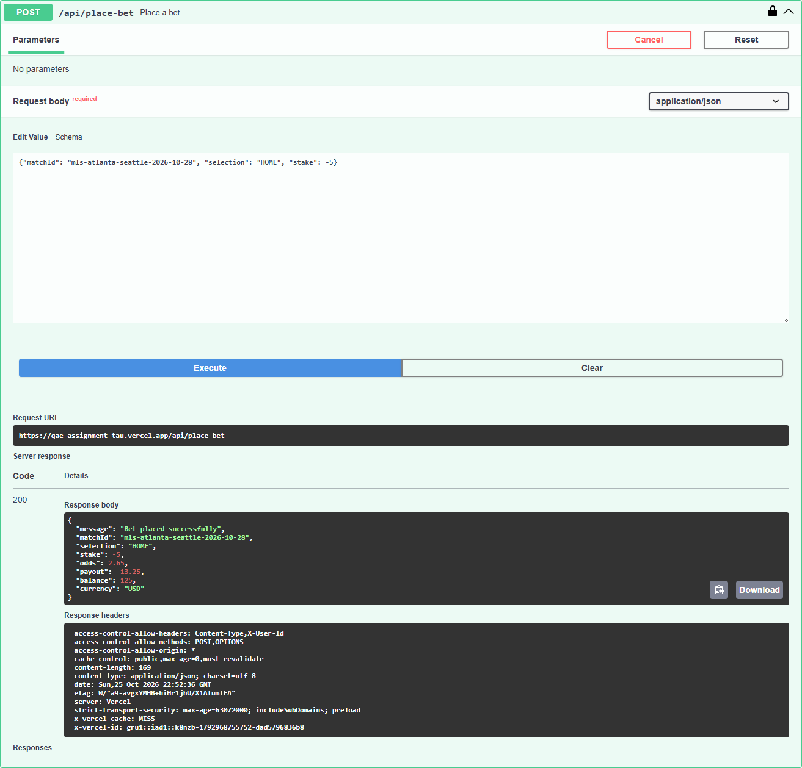

---

### BUG-02 – Balance can go negative, through the API and through the normal UI

**Severity:** Critical

**Reproduction steps (UI only, no developer tools)**
1. Bring the balance to €20.00 (reset, then one €100.00 bet) and reload the page.
2. Select Atlanta United vs Seattle Sounders → 1, stake `15.00`, Place Bet, close the receipt.
   The header still shows €20.00 (BUG-07); the real balance is €5.00.
3. Without reloading, select the same odds, stake `15.00`, Place Bet.
4. Reload the page.

**Reproduction steps (API)**
1. With a balance of €20.00, `POST /api/place-bet` with stake `20.01`.

**Expected:** a stake above the available balance is rejected on UI and API, with "Insufficient
balance" (§4.1, §4.4). The balance never goes below €0.00.

**Actual:**
- UI: step 3 is enabled and accepted, because the slip checks the stake against the stale €20.00.
  After reload, header and slip show **€-10.00**.
- API: stake `20.01` returns `200`, balance **−€0.01**; further bets are still accepted at a negative balance.
- The UI check itself works on a freshly loaded page ("Insufficient balance", button disabled); the
  server never checks.

**Business impact:** Any customer can bet money they do not have just by placing two bets in a row,
creating uncollectable debt and breaching responsible-gambling controls.

**Evidence:**

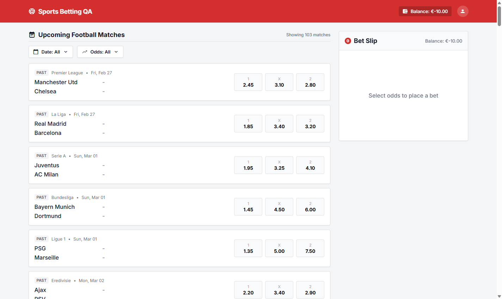


---

### BUG-03 – Matches already played are listed as upcoming and accept bets

**Severity:** Critical

**Reproduction steps (UI)**
1. Open the app and look at the top of "Upcoming Football Matches".
2. Select Manchester Utd vs Chelsea (PAST, Fri Feb 27) → 1, stake `5.00`, Place Bet.

**Reproduction steps (API)**
1. `POST /api/place-bet` with `{"matchId": "premier-league-manutd-chelsea", "selection": "HOME", "stake": 5}`.
2. Control: the same request for `mls-atlanta-seattle-2026-10-28`.

**Expected:** only upcoming matches are listed and accept bets (§1, §2.1, §3 "Event type"); the bet on
the past match is rejected on both layers, the control bet accepted.

**Actual:** the list opens with matches from February tagged **PAST**; 86 of the 103 matches are dated
before the execution date. The UI bet is placed (receipt `#B-74128`, balance €120.00 → €115.00), and
so is the API bet (`200`). The control bet is accepted as expected.

**Business impact:** A bet on a match whose result is already known is a guaranteed win, exposing the
operator to direct losses and licensing action.

**Evidence:**

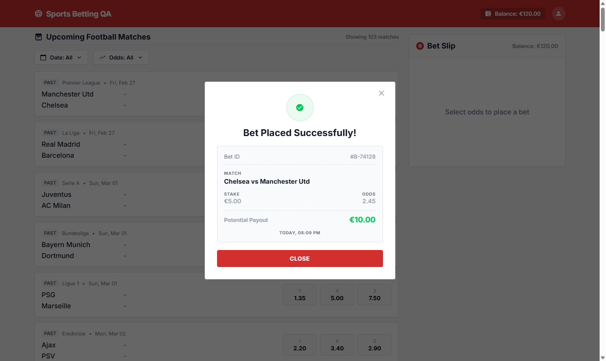

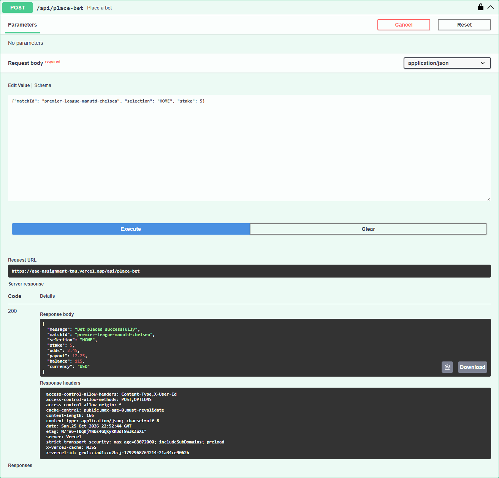

The list header with PAST matches is visible at the top of the BUG-02 UI screenshot above.

---

### BUG-04 – Simultaneous requests can charge the same bet twice

**Severity:** High

**Reproduction steps**
1. Reset the balance (€120.00).
2. Send three identical `POST /api/place-bet` requests (stake 5) at the same instant.
3. `GET /api/balance`.

**Expected:** one `200`, the others `409 bet_in_progress`; balance €115.00 (§5.3).

**Actual:** in **2 of 3 runs**, two requests returned `200` and the balance dropped to €110.00. The
lock exists (one request got `409`) but does not cover the whole processing window.

**Business impact:** Retries, double submits or two open tabs can charge a customer twice for one bet.

**Evidence:** the three responses of run 1, all sent at 22:59:23.459 UTC (full log in
[`evidence/2026-10-25_api_exploratory.json`](evidence/2026-10-25_api_exploratory.json), group "concurrency"):

```text
answered 22:59:24.008  409  {"error": "bet_in_progress"}
answered 22:59:24.081  200  {"stake": 5, "balance": 115}
answered 22:59:24.550  200  {"stake": 5, "balance": 110}
GET /api/balance           {"balance": 110}     <- 120.00 before: charged twice
```

Two repeats a minute later, same requests:

```text
run 2: 409 ×1, 200 ×2 -> balance 120.00 -> 110.00 (charged twice)
run 3: 409 ×2, 200 ×1 -> balance 120.00 -> 115.00 (charged once)
```

---

### BUG-05 – Receipt shows a potential payout of stake × 2

**Severity:** High

**Reproduction steps**
1. Select Atlanta United vs Seattle Sounders → 1 (2.65), stake `10.00`. The slip shows €26.50.
2. Place the bet and read the receipt.

**Expected:** potential payout €26.50 = 10.00 × 2.65, as on the slip and in the API response
(Domain Context "Payout", "Bet Receipt").

**Actual:** **€20.00**. The API response for the same bet has `"payout": 26.5`, so the error is in the
receipt: it is built in the browser as stake × 2 and ignores the odds and the API response.

**Business impact:** The customer's confirmation states a wrong amount for every bet, which leads to
disputes and complaints.

**Evidence:**

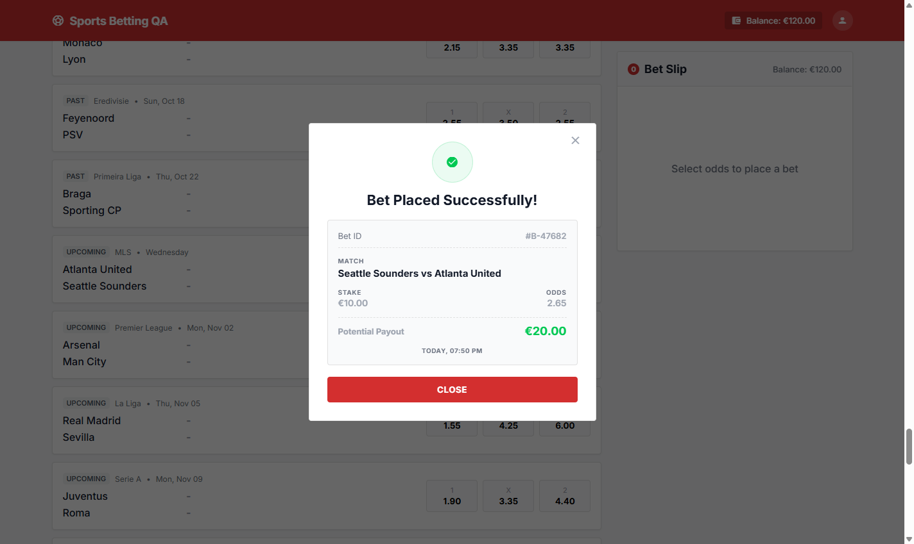

---

### BUG-06 – Receipt names the away team first

**Severity:** High

**Reproduction steps:** as BUG-05; compare the receipt's match with the match list.

**Expected:** "Atlanta United vs Seattle Sounders", home team first, as in the list (Domain Context
"Match Ordering").

**Actual:** "**Seattle Sounders vs Atlanta United**".

**Business impact:** A customer who backed the home team reads a receipt that suggests they backed
the other team, which leads to disputes about what was bet.

**Evidence:** the receipt shows "Seattle Sounders vs Atlanta United", while the match list behind the
modal shows Atlanta United first:


---

### BUG-07 – Header and slip balance stay stale after a bet

**Severity:** High

**Reproduction steps**
1. Note the header balance (€120.00).
2. Place a €10.00 bet and close the receipt.
3. Compare header and slip with `GET /api/balance`; then reload.

**Expected:** header and slip show €110.00 straight away (§2.3 "stake is deducted"; Domain Context
"Balance").

**Actual:** both keep showing **€120.00** while the API returns €110.00, until the page is reloaded.

**Business impact:** Customers see money they no longer have, and the slip validates new stakes
against it, which is what makes BUG-02 reachable from the UI.

**Evidence:**

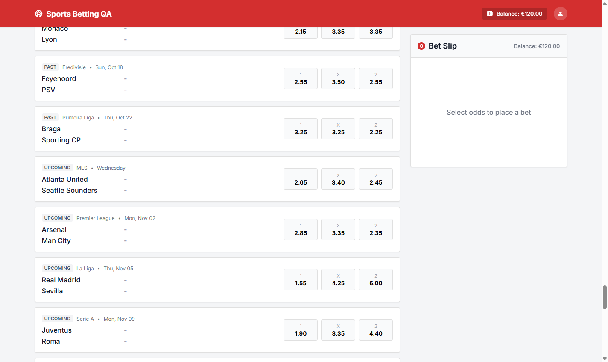

---

### BUG-08 – Receipt has no selection, and its Bet ID and time come from the browser

**Severity:** Medium

**Reproduction steps:** place any bet and read every field of the receipt.

**Expected:** the receipt shows Bet ID, match, **selection**, stake, odds, payout and placement time
(§2.4), describing the bet the server recorded.

**Actual:**
- No selection is shown (Home / Draw / Away), although the slip showed "Match Winner: Home".
- The Bet ID (e.g. `#B-47682`) is a random 5-digit number created by the browser before the request
  is sent; the API returns no bet id, so the server cannot find a bet by this number.
- The time is the customer's local clock, always labelled "Today".

**Business impact:** The receipt cannot prove which outcome was bet or be traced by support, so
disputes cannot be resolved.

**Evidence:** the receipt has Bet ID, match, stake, odds, payout and time, but no selection:


The `place-bet` response has no id field, so `#B-47682` exists only in the browser:


---

### BUG-09 – Slip promises a payout one cent higher than the one recorded

**Severity:** Medium

**Reproduction steps**
1. Select Atlanta United vs Seattle Sounders → 1 (2.65), stake `1.01`. Read the slip payout.
2. Place the same bet through `POST /api/place-bet` and read `payout`.

**Expected:** the same amount in both: 1.01 × 2.65 = 2.6765 (the spec defines no rounding rule; test plan A4).

**Actual:** slip **€2.68** (rounded); API **€2.67** (truncated). Also 25.01 × 2.65 = 66.2765 → API `66.27`.

**Business impact:** Customers are settled below the amount they were shown, always in the operator's
favour; small per bet but systematic.

**Evidence:** API payout `2.67` in [`evidence/2026-10-25_api_tc02_tc03.json`](evidence/2026-10-25_api_tc02_tc03.json)
(step "stake 1.01"); the slip for the same stake and odds:

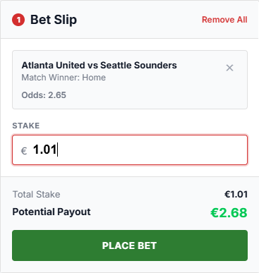

---

### BUG-10 – Date filter shows matches one day early for users west of UTC

**Severity:** Medium

**Reproduction steps**
1. In a browser set to America/Sao_Paulo (UTC−3), open the date filter.
2. Select a single day, 28/10/2026 (Atlanta United vs Seattle Sounders, card "Wednesday"), Apply.
3. Repeat with 27/10/2026.

**Expected:** day 28 shows the match (§2.6).

**Actual:** day 28 shows **no matches**; day 27 shows the match. With the browser time zone set to
Europe/London, day 28 shows it correctly.

**Business impact:** Every user in the Americas gets wrong results from the date filter and can miss
the matches they are looking for.

**Evidence:**

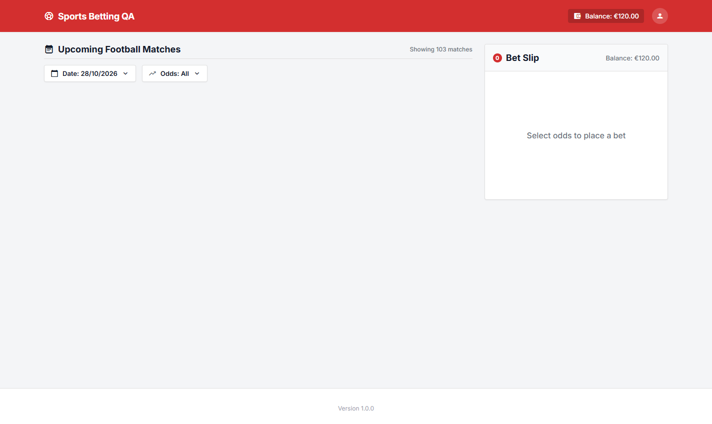

Day 27 result: [`evidence/2026-10-25_explore_date-filter-day-27.png`](evidence/2026-10-25_explore_date-filter-day-27.png).

---

### BUG-11 – Odds filter hides matches on its lower bound and accepts a reversed range

**Severity:** Medium

**Reproduction steps**
1. Odds filter: min `2.45`, max `3.40`, Apply. Atlanta United vs Seattle Sounders has 2.65 / 3.40 / 2.45,
   all inside or on the bounds.
2. Odds filter: min `5.00`, max `2.00`, Apply.

**Expected:** bounds are inclusive, so the match is shown; an invalid range is rejected with clear
feedback (§2.6).

**Actual:** step 1 hides the match (any match with an odd equal to the minimum is excluded); step 2 is
applied silently and shows an empty list.

**Business impact:** Users filtering by price miss matching markets, and an empty list with no
explanation looks like the product has no events.

**Evidence:**

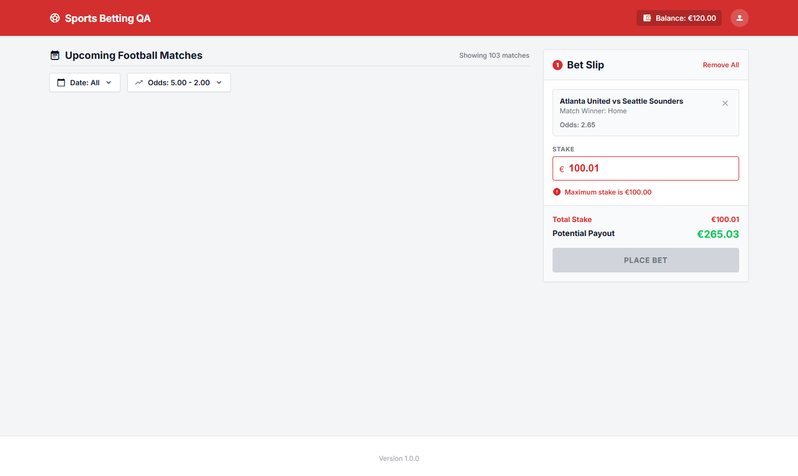

Bounds case: [`evidence/2026-10-25_explore_odds-filter-bounds.png`](evidence/2026-10-25_explore_odds-filter-bounds.png).

---

### BUG-12 – Balance reset reports €125.50 but stores €120.00

**Severity:** Medium

**Reproduction steps:** `POST /api/reset-balance`, then `GET /api/balance`.

**Expected:** both €125.50, the initial balance (Domain Context "Balance"); §5.3: "Response body and
persisted state must be consistent after reset."

**Actual:** the reset response says `125.5`; the persisted balance is `120`. Reproduced three times. A
new account does start at €125.50, so only the reset is wrong.

**Business impact:** Tools that trust the reset response work with a balance €5.50 higher than the
real one, and every reset account starts below the documented amount.

**Evidence:**

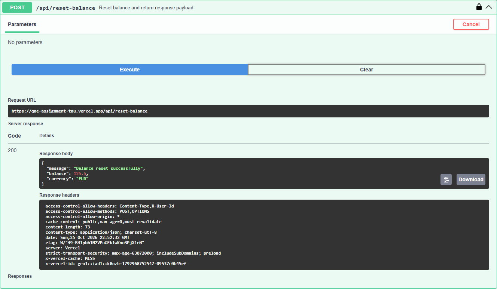

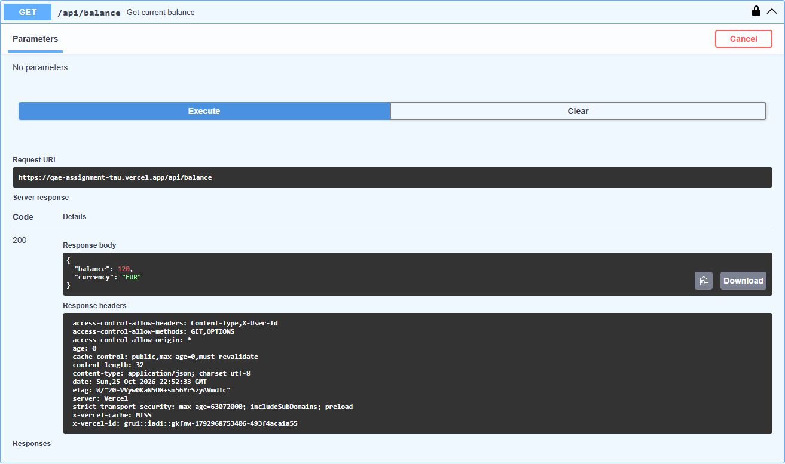

---

### BUG-13 – Bet confirmation reports the currency as USD

**Severity:** Medium

**Reproduction steps:** place any bet with `POST /api/place-bet`; then call `GET /api/balance`.

**Expected:** `"currency": "EUR"` in both (§3 "Currency", §5.3).

**Actual:** every successful `place-bet` response has `"currency": "USD"`; balance and reset responses
have `"EUR"`.

**Business impact:** Any system that records or reconciles bets from this response books them in the
wrong currency.

**Evidence:** `place-bet` response with `"currency": "USD"`:


`GET /api/balance` for the same account with `"currency": "EUR"`:


---

## Minor findings

| Finding | Expected | Actual | Evidence |
|---------|----------|--------|----------|
| Malformed JSON body (`{bad`) | `400 invalid_json` (§4.3, §5.3) | `500 internal_server_error` | api_exploratory.json |
| `GET /api/place-bet` | `405`; `401` without a user id (§4.3) | `200 {}`, also without a user id | api_exploratory.json |
| Empty request body | `400` (§4.3) | `422 invalid_match_id` | api_exploratory.json |
| Slip balance with a selection active | slip shows available balance (§2.2) | replaced by "Remove All" | reversed-range screenshot |
| "Showing N matches" with a filter applied | number of visible matches | always "Showing 103 matches" | filter screenshots |
| Payout shown for an invalid stake | greyed out, like the disabled button | shown in green (e.g. €265.03 for 100.01) | reversed-range screenshot |
| Stake typed as `1.2.3` | rejected, or kept as `1.2` (§4.4: single separator) | becomes `1.23` without notice | [screenshot after typing `1.2.3`](evidence/2026-10-25_explore_stake-input-rewrite.png) |
| Negative balance format | `−€10.00` | `€-10.00` | BUG-02 UI screenshot |

## Exploratory notes

Checked and working as specified:
- Authentication: every endpoint returns `401` with no, blank or unknown `x-user-id`.
- Unsupported methods return `405` on every route except `GET /api/place-bet` (minor findings).
- `selection` (missing, lowercase, padded, unknown, null) and `matchId` (missing, empty, blank, unknown)
  are rejected with `422` and the documented codes.
- Extra body fields (`"odds": 1000`, `"payout": 9999`) are ignored; the server uses catalogue odds.
- UI stake messages for `0.99`, `100.01` and an over-balance stake on a fresh page; the input drops a
  minus sign and a third decimal.

Not reproduced: a `409` reaching the UI. In 5 attempts the UI sent its request after the parallel API
bet had finished. Code reading shows any non-2xx response opens the same "Something went wrong" modal
with Rebet; this follows §2.3, but Rebet cannot help after a validation error (open question for Product).
